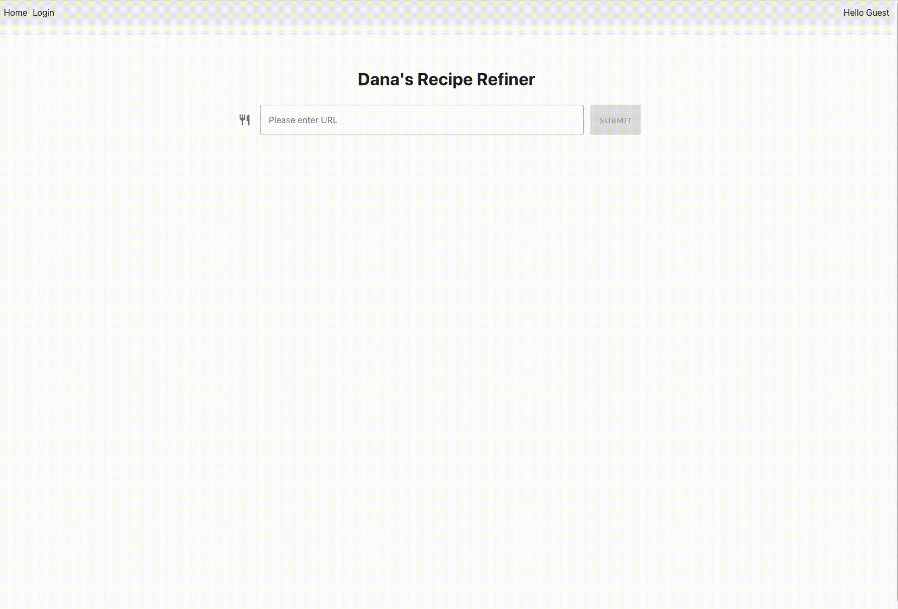

# RecipeRefiner
Recipe Refiner is a web application that lets users submit a recipe URL and receive a simplified, 
clean version of the recipe — skipping ads, pop-ups, and cluttered websites. 

Backend implemented with Django.
Frontend implemented with React.

Features
- Simplified Recipes: Users provide a recipe URL and get a clean, readable version.
- Recipe History: Saves up to the last 20 recipes for registered users.

## Hosting

The app runs on Render's free plan, which puts a service to sleep after 15 minutes without traffic.
To keep production awake, a [cron-job.org](https://cron-job.org) job pings
https://reciperefiner.onrender.com/ every 10 minutes. It pings `/` because that returns 200
without touching the database. Only production is pinged: free instance hours are shared across
the workspace, and keeping dev awake too would use them up before the month ends.

-----
## Acknowledgments / Credits

Core functionality in this app uses the [**recipe-scrapers**](https://github.com/hhursev/recipe-scrapers) Python library to parse recipe pages (ingredients, instructions, etc.).  
Thank you to the maintainers of **recipe-scrapers** for enabling robust recipe extraction in my project.  

